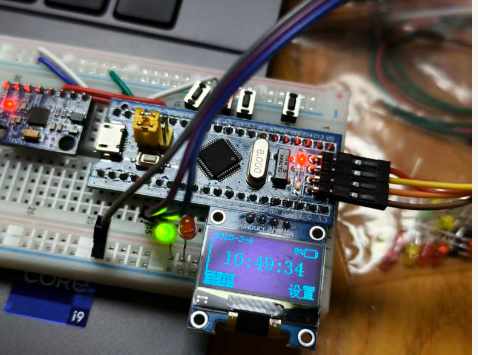
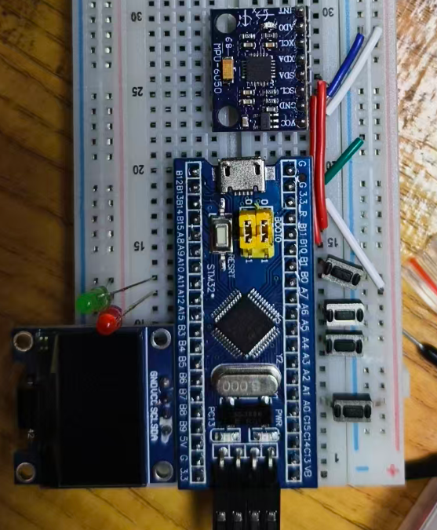
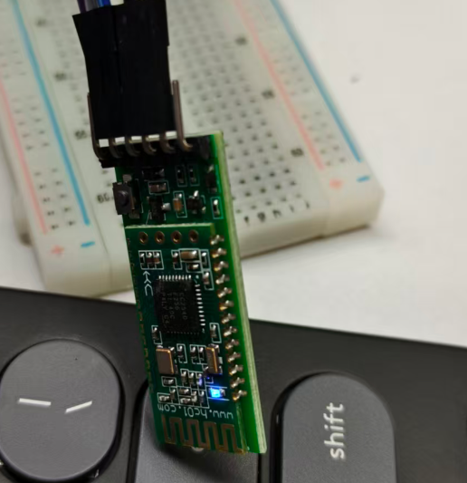
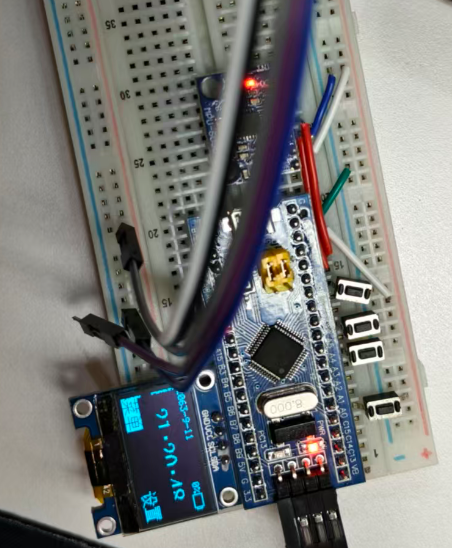
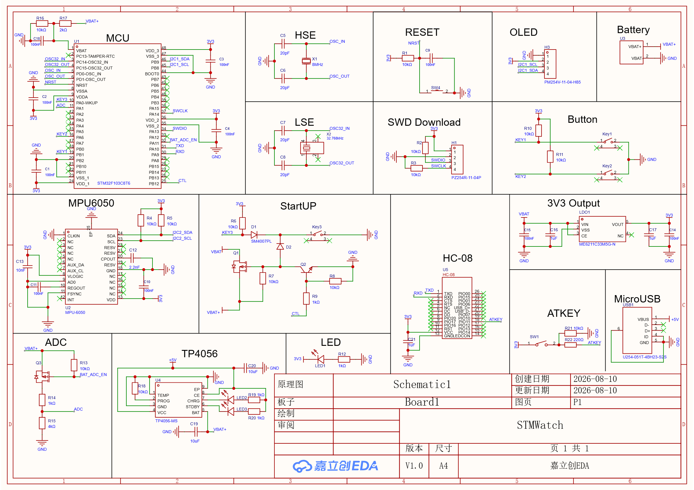
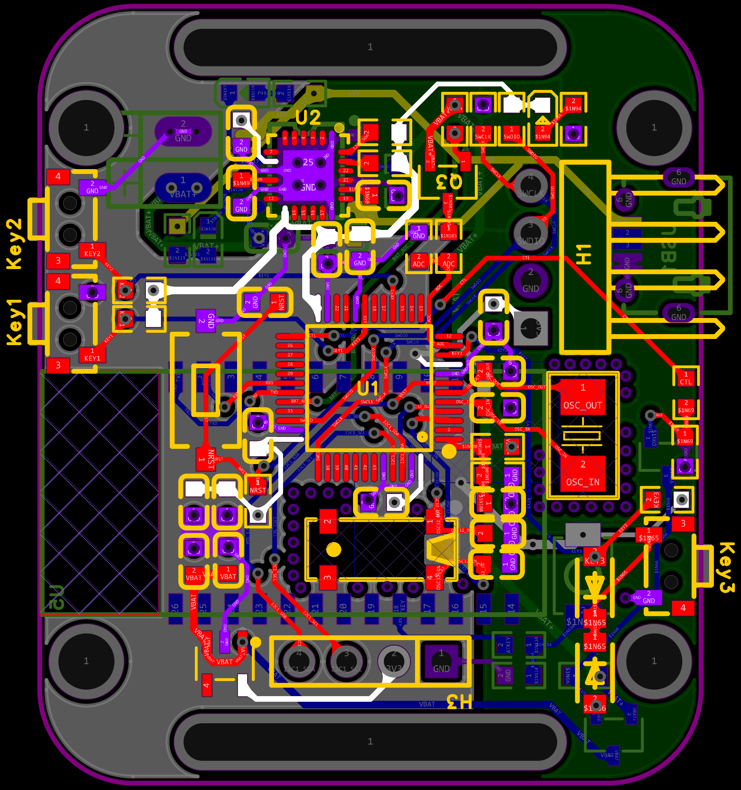
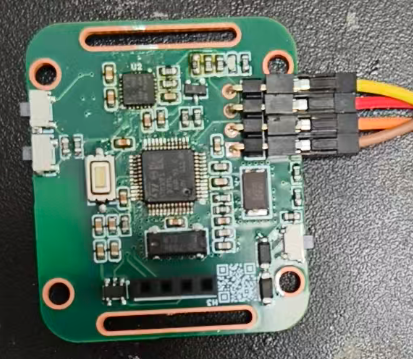
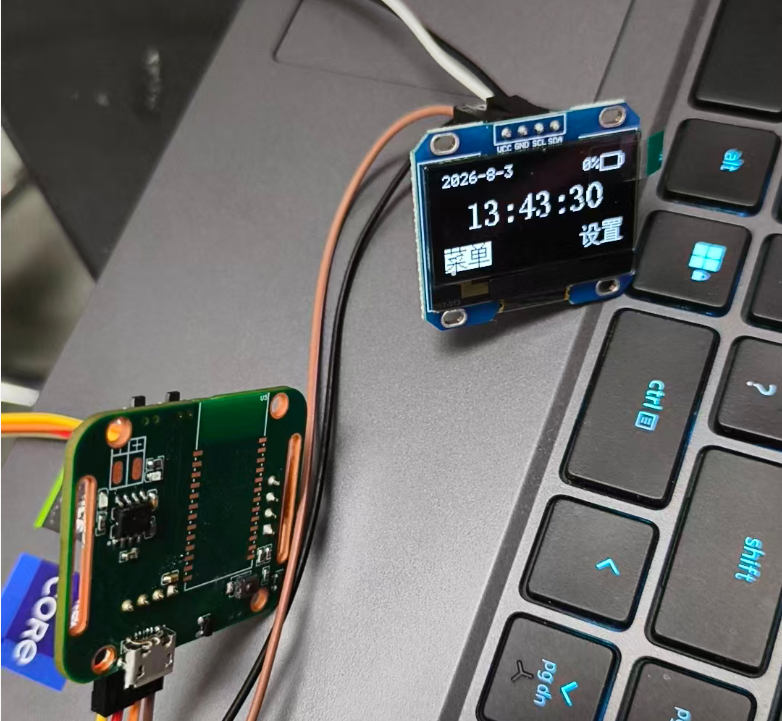

# STM32 + HC-08 蓝牙手表

[English](README.md) | **简体中文**

**个人学习项目｜2026.07–2026.08**

基于 [BQT0411/STM32-WATCH](https://github.com/BQT0411/STM32-WATCH) 二次开发，以 STM32F103C8T6 为主控，完成代码重构、功能扩展、HAL 移植，以及原理图绘制、PCB 设计与焊接。

## 个人工作与项目状态

- **FSM 重构**：整理参考工程的代码风格，将菜单主逻辑重构为有限状态机，后续各功能交互也按状态组织；重新设计秒表和倒计时 UI。
- **功能扩展**：新增倒计时、HC-08 蓝牙校时，以及空闲超时进入 Standby、通过 PA0 唤醒的逻辑。
- **双版本源码**：先完成标准库版，再以此为基础移植到 HAL 库。
- **硬件实践**：完成原理图绘制、PCB 设计、两块板子的焊接与上电测试。

新增、重构和移植代码均以练习为目的手写，未使用 AI 生成或修改；参考工程及第三方代码的来源见文末。

| 版本 / 硬件 | 当前状态 |
| --- | --- |
| **标准库版 + 面包板** | 全部已实现功能正常；RTC 计时、本地及蓝牙校时、复位后的时间保持均正常。 |
| **HAL 移植版** | RTC 存在 Bug，复位后会卡死、时间清零，尚未修复。 |
| **焊接 PCB** | 两块板均可烧录，主体逻辑可运行；MPU6050 损坏、按键识别不稳定，未完成全功能成品。 |

标准库版已实现：**时钟与日期、本地设置、蓝牙校时、秒表、倒计时、水平仪、小恐龙游戏、电量指示、待机唤醒**。`Alarm` 仅为菜单占位，未实现。

HAL RTC 与 PCB 问题记录

**HAL RTC**：移植时参考 HAL 库内部实现，编写 `My_RTC_WriteTimeCounter` 和 `My_RTC_ReadTimeCounter`，直接访问 RTC 的 CNT 计数器。复位后卡死、时间清零的问题尚未完成根因定位，当前保留原实现。相关代码见 [RTC 模块](firmware/HAL/Core/System/Src/MyRTC.c)与[初始化入口](firmware/HAL/Core/Src/main.c)。

**PCB**：第一块板上电时因焊接短路烧毁了 ST-Link 的 3.3 V 稳压芯片，之后直接以 5 V 给板子供电，导致 MPU6050 损坏。供电错误在第二块板测试后才被发现，此时两块板均已接入过 5 V，MPU6050 均无法正常工作。按键也经常漏检，初步判断与 PCB 布线干扰有关，但尚未通过进一步测量确定具体原因。因此，面包板完成了功能验证，PCB 则停留在焊接与局部测试阶段。

## 项目图片

*面包板运行中的时钟主页。*

面包板接线、HC-08 与蓝牙校时

原理图与 PCB 设计

PCB 焊接与局部运行测试（非全功能成品）

硬件资料目前仅包含图片，未提供 EDA 可编辑工程或 Gerber 文件。

## 技术实现与源码

硬件包括 STM32F103C8T6、I²C OLED、MPU6050、HC-08、按键、电池接口、TP4056 充电电路、ME6211 3.3 V 稳压电路和 SWD 接口。

软件由主循环处理页面交互，TIM2 提供约 1 ms 节拍，驱动按键扫描、计时和游戏更新等逻辑。菜单按当前状态分派处理函数，倒计时分别管理运行状态和设置页面；空闲约 120 秒进入 Standby。电量通过 ADC 采样显示，未测量电量精度或续航。

蓝牙校时通过 HC-08 与 USART1 接收 ASCII 格式的 Unix 秒时间戳，完成组帧、时间转换和 RTC 更新，日期时间按 UTC+8 显示。

### 工程入口

| 版本 | 开发工具 | 入口 |
| --- | --- | --- |
| 标准库版 | Keil5 | [App_Watch.uvprojx](firmware/StdPeriph/App_Watch.uvprojx) |
| HAL 版 | STM32CubeMX + Keil5 | [Keil 工程](firmware/HAL/MDK-ARM/STM32Watch_HAL.uvprojx)、[CubeMX 配置](firmware/HAL/STM32Watch_HAL.ioc) |

## 参考与致谢

- [BQT0411/STM32-WATCH](https://github.com/BQT0411/STM32-WATCH)：主要参考工程，小恐龙游戏也来自该项目。
- 江协科技 OLED 驱动等第三方代码：保留原有来源说明与版权声明。
- STMicroelectronics 标准外设库、HAL 库及 ARM CMSIS：保留原有文件和许可说明，见 [HAL 驱动许可](firmware/HAL/Drivers/STM32F1xx_HAL_Driver/LICENSE.txt)与 [CMSIS 许可](firmware/HAL/Drivers/CMSIS/LICENSE.txt)。

本仓库未添加覆盖全部组件的统一许可证，使用时请分别查看原始来源及适用许可。
